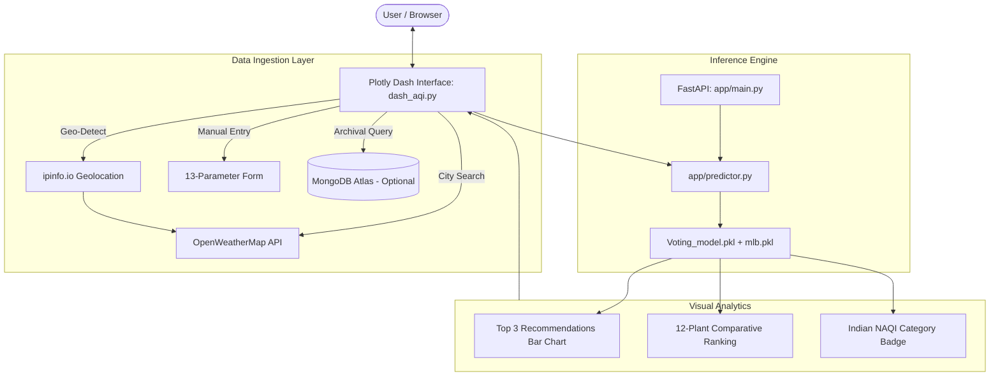

# 🌿 AQI-Based Plant Recommendation System

[](https://www.python.org/)
[](https://dash.plotly.com/)
[](https://fastapi.tiangolo.com/)
[](https://scikit-learn.org/)
[](LICENSE)

An intelligent, data-driven environmental platform that analyzes live atmospheric air quality metrics and recommends optimal air-purifying indoor and outdoor plants using phytoremediation modeling and a pre-trained **Scikit-Learn Voting Classifier**.

---

## 📖 Overview

Ambient air pollution (elevated $\text{PM}_{2.5}$, $\text{PM}_{10}$, nitrogen oxides, sulfur dioxide, and volatile organic compounds) poses severe respiratory and systemic health hazards. Certain botanical species act as natural bio-filters through **phytoremediation**—absorbing gaseous pollutants through leaf stomata, sequestering particulates on foliage, and breaking down toxins in the rhizosphere.

This application pairs **real-time air quality data** with an **ensemble machine learning model** to deliver personalized botanical recommendations based on specific local pollution profiles.

---

## 🎯 Key Features

### 1. Multi-Modal Environmental Data Ingestion
- **🔍 City Search**: Query any city worldwide to retrieve real-time atmospheric measurements via the OpenWeatherMap Air Pollution API and Geocoding service.
- **📍 Auto-Location Detection**: One-click geo-detection using public IP coordinates (`ipinfo.io`) for instant local analysis.
- **💾 Historical Archival Lookup**: Integrated MongoDB Atlas client with fail-safe timeouts to retrieve historical city pollution logs.
- **✏️ Manual Parameter Tuning**: Form inputs for all 13 atmospheric indicators, ideal for evaluating indoor sensor readings or experimental conditions.

### 2. Indian National AQI (NAQI) Computation
Computes real-time sub-indices according to official Central Pollution Control Board (CPCB) breakpoint standards for $\text{PM}_{2.5}$ and $\text{PM}_{10}$:
- 🟢 **Good (0–50)**: Minimal impact
- 🟢 **Satisfactory (51–100)**: Minor breathing discomfort to sensitive people
- 🟡 **Moderate (101–200)**: Breathing discomfort to people with lungs, asthma, and heart diseases
- 🟠 **Poor (201–300)**: Breathing discomfort to most people on prolonged exposure
- 🔴 **Very Poor (301–400)**: Respiratory illness on prolonged exposure
- 🟣 **Severe (401–500+)**: Affects healthy people and seriously impacts those with existing diseases

### 3. Machine Learning Recommendation Engine
- **Model Pipeline**: `StandardScaler` feature normalization followed by a multi-label `OneVsRestClassifier` wrapping a soft-voting `VotingClassifier` ensemble:
  - **Logistic Regression** (`max_iter=500`)
  - **Decision Tree Classifier**
  - **Gaussian Naive Bayes**
- **13 Evaluated Features**:
  $$\text{PM}_{2.5}, \text{PM}_{10}, \text{NO}, \text{NO}_2, \text{NO}_x, \text{NH}_3, \text{CO}, \text{SO}_2, \text{O}_3, \text{Benzene}, \text{Toluene}, \text{Xylene}, \text{AQI}$$
- **Zero-Latency Local Inference**: Operates directly in-memory via Scikit-Learn without network overhead or third-party cloud downtime.
- **Dual-Mode Execution**: Can run self-contained inside the Dash app or connect to a dedicated FastAPI microservice via `API_URL`.

### 4. Interactive Analytical Visualizations
- **Top 3 Recommended Species**: Color-coded bar chart displaying the highest-ranking plants with confidence scores.
- **Comparative Suitability Chart**: Horizontal ranking across all 12 candidate botanical species.
- **Dynamic Category Badging**: Real-time NAQI health alert badge with synchronized color-coding.

---

## 🌿 Supported Botanical Species

| Plant Species | Botanical Name | Primary Target Pollutants | Placement |
| :--- | :--- | :--- | :--- |
| **Snake Plant** | *Sansevieria trifasciata* | Benzene, Formaldehyde, Toluene, $\text{NO}_x$ | Indoor / Bedroom |
| **Areca Palm** | *Dypsis lutescens* | Toluene, Xylene, Acetone, Particulates | Indoor / Living Room |
| **Spider Plant** | *Chlorophytum comosum* | Carbon Monoxide, Formaldehyde, Xylene | Indoor / Balcony |
| **Peace Lily** | *Spathiphyllum* | Ammonia, Benzene, Trichloroethylene | Low-light Indoor |
| **Aloe Vera** | *Aloe barbadensis* | Benzene, Formaldehyde | Sunny Indoors / Sills |
| **Money Plant** | *Epipremnum aureum* | VOCs, Benzene, Formaldehyde, CO | Indoor / Water or Soil |
| **Boston Fern** | *Nephrolepis exaltata* | Formaldehyde, Xylene, Particulates | Humid Indoor / Bathroom |
| **Ficus** | *Ficus benjamina* | Formaldehyde, Octanal, VOCs | Bright Indoor / Office |
| **Rubber Plant** | *Ficus elastica* | Carbon Monoxide, Formaldehyde, Toxins | Indoor Living Areas |
| **Pothos** | *Epipremnum pinnatum* | Ozone, Particulates, Benzene | Indoor / Hanging Pots |
| **Tulsi (Holy Basil)** | *Ocimum sanctum* | $\text{SO}_2$, $\text{CO}_2$, Airborne Microbial Pathogens | Outdoor / Veranda |
| **Neem** | *Azadirachta indica* | Heavy Particulates, $\text{SO}_2$, Industrial Exhaust | Outdoor / Garden |

---

## 🏗️ System Architecture



---

## 🚀 Quick Start Guide

### 1. Clone the Repository
```bash
git clone https://github.com/ironhide554/AQI-Plant-Recommender.git
cd AQI-Plant-Recommender
```

### 2. Install Dependencies
```bash
pip install -r requirements.txt
```

### 3. Environment Configuration (Optional)
The system includes safe fallbacks and a working OpenWeatherMap API key by default. To configure your own keys or database:
```bash
cp .env.example .env
```

Configuration variables available in `.env`:
| Variable | Description | Default |
| :--- | :--- | :--- |
| `OWM_API_KEY` | OpenWeatherMap Air Pollution API Key | Pre-configured key |
| `MONGO_URL` | MongoDB Atlas Connection URI | Blank (runs in local mode) |
| `MONGO_DB` | Database Name | `AirQuality` |
| `API_URL` | Optional external FastAPI URL | Blank (direct local inference) |

### 4. Launch the Dashboard
```bash
python dash_aqi.py
```
Open **`http://127.0.0.1:8050`** in your browser.

---

## 🔌 Standalone REST API Microservice

You can optionally run the model as an independent FastAPI service for external integrations:

```bash
uvicorn app.main:app --reload --port 8000
```

- **Interactive Swagger Documentation**: `http://127.0.0.1:8000/docs`
- **ReDoc Documentation**: `http://127.0.0.1:8000/redoc`
- **Health Check**: `GET /health`
- **Prediction Endpoint**: `POST /predict`

#### Sample JSON Payload (`POST /predict`):
```json
{
  "PM2.5": 55.0,
  "PM10": 95.0,
  "NO": 18.0,
  "NO2": 28.0,
  "NOx": 46.0,
  "NH3": 14.0,
  "CO": 2.1,
  "SO2": 9.0,
  "O3": 24.0,
  "Benzene": 2.2,
  "Toluene": 9.5,
  "Xylene": 3.8,
  "AQI": 145.0
}
```

---

## 🧪 Automated Testing Suite

The repository includes a comprehensive 7-point verification suite covering model inference, schema integrity, AQI formulas, live weather connectivity, and UI figure rendering:

```bash
python test_system.py
```

#### Test Execution Summary:
```
============================================================
🧪 RUNNING AQI-PLANT-RECOMMENDER SYSTEM TESTS
============================================================
[Test 1] Testing ML Predictor & MultiLabelBinarizer...      ✅ Passed
[Test 2] Testing PM2_5 alias key normalization...           ✅ Passed
[Test 3] Testing FastAPI app handlers...                    ✅ Passed
[Test 4] Testing India AQI breakpoint calculations...       ✅ Passed
[Test 5] Testing OpenWeatherMap API connectivity...         ✅ Passed
[Test 6] Testing Dash prediction callback rendering...      ✅ Passed
[Test 7] Testing empty input validation guard...            ✅ Passed
============================================================
📊 SUMMARY: 7/7 tests passed.
============================================================
```

---

## 📁 Repository Structure

```
AQI-Plant-Recommender/
│
├── dash_aqi.py             # Interactive Plotly Dash frontend application
├── requirements.txt        # Full Python runtime dependencies
├── test_system.py          # End-to-end automated verification test suite
├── .env.example            # Environment variables configuration template
├── .gitignore              # Git ignore rules for credentials & cache
├── README.md               # Complete platform documentation
│
└── app/                    # Machine Learning & Backend Microservice
    ├── predictor.py        # Centralized in-memory ML inference engine
    ├── main.py             # FastAPI REST application
    ├── data.py             # Pydantic v2 data validation schemas
    ├── Voting_model.pkl    # Pre-trained Scikit-Learn VotingClassifier pipeline
    └── mlb.pkl             # MultiLabelBinarizer model for 12 plant species
```

---

## 🛡️ Security & Reliability Best Practices
- **Credential Protection**: Plaintext database credentials and secrets are excluded from code and managed via `.env`.
- **Fault-Tolerant Network Fallbacks**: MongoDB lookups enforce strict connection timeouts (2000 ms) and fall back gracefully to live APIs without UI freezing.
- **Windows Console Safe**: Standard I/O reconfigured for UTF-8 compatibility across all operating systems.

---

## 📜 License
This project is licensed under the **MIT License** - see the [LICENSE](LICENSE) file for details.
